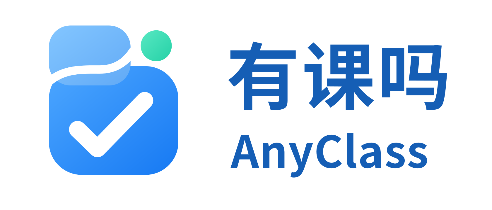

<h1>AnyClass</h1>

<strong>Wondering if you have class today? Open AnyClass and know right away.</strong>

  <a href="https://anyclass.heyaaron.asia/"><strong>Open AnyClass</strong></a>
  ·
  <a href="#features">Features</a>
  ·
  <a href="#compatibility">Compatibility</a>
  ·
  <a href="#roadmap">Roadmap</a>

  
  
  
  

  <a href="README.md">简体中文</a> | English

---

**AnyClass** is a local-first timetable tool for students. It helps you check today's classes, view weekly schedules, import course data, manage multiple timetables, and export schedules to the system calendar.

**Web app:** https://anyclass.heyaaron.asia/

> Hosted Production is **v0.2.2 / v022-production-20261016-154638**, using database Schema 4. Website technical acceptance, formal archival and owner-reported iPhone/iPad acceptance are complete. The public source was aligned with the accepted Hosted Build through [PR #13](https://github.com/heyaaron-Wu/AnyClass/pull/13); GitHub Tag / Release and Hosted Build retain separate identities. See [release identity and closeout gates](docs/v022-navigation-hotfix-candidate.md).

Official universal Shortcut: [AnyClass·课程导入](https://anyclass.heyaaron.asia/shortcuts/install), **1.0.0 / Build 1**. Choose Stable or Beta when running it; their data remains isolated. Installation requires explicit user confirmation. No newer release exists, and the update Manifest remains disabled.

## Features

Historical Beta candidate records: [client clock capture and floating preview](docs/v022-beta4-candidate.md) and [floating-preview visual consistency](docs/v022-beta5-candidate.md). Their contemporaneous status is preserved; it is not the current deployment status.

- Today's classes and current / next class
- Weekly timetable
- Multiple timetable management and active timetable switching
- Course editing and local timetable metadata editing
- Unified Preview for imports
- Academic-system / Bookmark / file / clipboard / AI-assisted import flows
- The currently selected timetable is the default import target
- Duplicate-course and conflict checks
- Apple Calendar / iCalendar (ICS) export
- Course reminders
- Period and display-range settings
- Local-first: timetable data is stored on the current device by default

## Import behavior

AnyClass currently treats **Course data** as the core import model:

- Imported data enters Unified Preview before being saved.
- The currently selected timetable is the default destination; source identity does not silently redirect to another timetable.
- Generic imports do not fabricate school IDs just to satisfy validation.
- Required missing metadata, such as school name, must be confirmed before save.
- AI-assisted import produces AnyClass course data only; it does not directly create system calendar events.
- **ICS import has been removed; ICS export remains available.**

## Privacy

AnyClass follows a **local-first** design.

- Timetable data is stored locally in the browser by default.
- The current product does not upload timetable data to the AnyClass server.
- AnyClass does not require storing your school account password.
- The current import flow does not upload Cookies, Sessions, or authentication tokens.

See [PRIVACY.md](PRIVACY.md) for details.

## Compatibility

| Academic system | Status |
| --- | --- |
| ZhengFang V9 | ✅ Verified |
| QiangZhi | Not supported |
| Kingosoft | Not supported |
| URP | Not supported |
| Wisedu | Not supported |

“Verified” means the import flow has been validated in a real environment. Public project documentation does not use a specific school as compatibility promotion.

## Apple Calendar

AnyClass currently keeps **ICS export**.

On iPhone or iPad, the ICS file exported by AnyClass can be handed off to the system calendar for import. AnyClass no longer provides ICS-file import back into the timetable.

## Roadmap

Planned areas include:

- Additional academic-system adapters
- Android calendar experience
- Schedule changes / make-up classes
- Exam arrangements
- Calendar Subscription
- More complete multi-term management
- Student utilities such as campus maps / classroom navigation

Roadmap items are plans, not currently available features.

## Open-source status

**The hosted website runs v0.2.2; see [GitHub Releases](https://github.com/heyaaron-Wu/AnyClass/releases) for the current source release.** Hosted Build and GitHub source Tag are separate version identities.

For normal use, the hosted [AnyClass web app](https://anyclass.heyaaron.asia/) remains the recommended entry point. This repository is primarily for source review, issue reporting, compatibility work, and development collaboration.

> **Repository source status:** the v0.2.2 public source is aligned with the accepted Hosted Build through [PR #13](https://github.com/heyaaron-Wu/AnyClass/pull/13), including the full product functionality rather than version-string changes alone. For current GitHub Tag / Release publication status, refer to [Releases](https://github.com/heyaaron-Wu/AnyClass/releases). The ISSUE-001 strict full-history privacy gate remains separate and cannot be satisfied by current-source review alone.

## Contributing

See [CONTRIBUTING.md](CONTRIBUTING.md).

Please never submit school account passwords, Cookies, Sessions, authentication tokens, or private student data in Issues or Pull Requests.

## Security

See [SECURITY.md](SECURITY.md).

## License

[Apache-2.0](LICENSE) · Copyright 2026 Aaron
